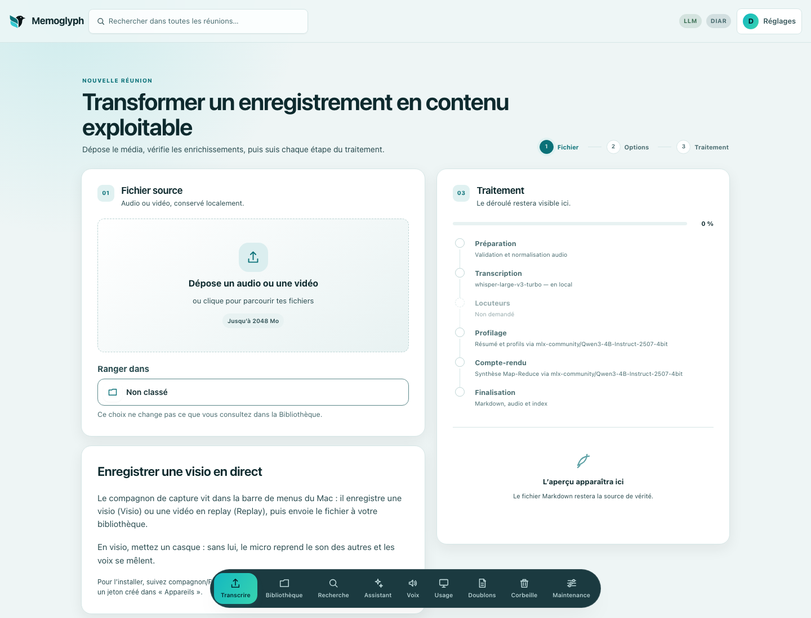

<!-- Fichier généré : modifier readme/, puis make readme -->
<p align="center">
  <picture>
    <source media="(prefers-color-scheme: dark)" srcset="docs/assets/brand/memoglyph-logo-horizontal-sombre.svg">
    
  </picture>
</p>

# Memoglyph

*[English](README.md) · Français*

**Transcripts et comptes rendus de réunion, en local par défaut, avec des citations vérifiables dans l'audio.**


*La bibliothèque : les réunions d'un projet.*

<sub>Les captures de réunions de cette page montrent des données de démonstration uniquement : la réunion IS1009a de l'AMI Meeting Corpus (University of Edinburgh et partenaires du projet AMI), sous licence [CC BY 4.0](https://creativecommons.org/licenses/by/4.0/). Référence : J. Carletta et al., « The AMI Meeting Corpus: A Pre-announcement », *Machine Learning for Multimodal Interaction* (MLMI), 2005.</sub>

## Le problème

Une réunion laisse des décisions, des actions et des chiffres difficiles à retrouver. L'enregistrement est long, le résumé est court, et rien ne relie les deux.

Un résumé écrit par un modèle peut aussi se tromper sans que cela se voie. Vérifier une affirmation suppose de retrouver le passage, puis la seconde d'audio où elle a été dite.

Memoglyph transforme un enregistrement en transcript horodaté et en compte rendu. Chaque affirmation gardée dans le compte rendu porte une citation vérifiée dans le transcript, et la citation ouvre l'audio à cette seconde.

## En trois gestes

### 1. Transcrire

Un fichier audio ou vidéo déposé sur l'écran Transcrire, jusqu'à 2 048 Mo par défaut, est rangé dans un projet et, par défaut, traité sur le Mac.


*L'écran Transcrire : fichier, projet et étapes du traitement.*

### 2. Lire

Le transcript montre la frise d'onde, les horodatages et, quand la diarisation est installée, les locuteurs.


*Une réunion : transcript avec locuteurs, frise d'onde et horodatages.*

### 3. Vérifier

Le compte rendu liste, selon le type de réunion, des décisions, des actions et des questions ouvertes. Les affirmations du compte rendu portent des citations horodatées, et un clic joue l'audio à cet instant.


*Un compte rendu dont les affirmations portent des citations horodatées ; un clic joue l'audio à cet instant.*

## Local ou en ligne, au choix

Par défaut, tout tourne sur le Mac : Whisper pour la transcription et un modèle de langage MLX local pour les comptes rendus et l'Assistant. La recherche sémantique utilise aussi, par défaut, un modèle d'embeddings local.

Un modèle en ligne peut s'ajouter au besoin : Mistral, OpenAI ou Anthropic, ou tout service au format OpenAI, tel que Groq, par le fournisseur `compatible`. Mistral peut aussi transcrire, avec Voxtral.

Les deux se combinent selon la sensibilité de chaque réunion. Un document étiqueté ultra-confidentiel ne part vers aucun fournisseur en ligne, sauf si son propriétaire l'autorise pour son compte. Détails : [docs/local-et-en-ligne.md](docs/local-et-en-ligne.md).

Il n'y a aucune télémétrie. L'usage est noté en local, et rien ne quitte la machine, sauf les appels aux fournisseurs choisis et, au premier usage, les téléchargements de modèles depuis Hugging Face.

## Démarrer en cinq commandes

Les prérequis sont un Mac Apple Silicon avec Homebrew, Python 3.11 avec [uv](https://docs.astral.sh/uv/), Node.js 20.19+ ou 22.12+, et `ffmpeg`. Ces commandes se lancent depuis un clone du dépôt.

```bash
brew install uv ffmpeg
uv sync --locked
npm --prefix ui ci
cp .env.example .env
./start.sh
```

L'application s'ouvre sur [http://127.0.0.1:8770](http://127.0.0.1:8770). Si ce port est pris, `./start.sh` choisit la paire libre suivante et affiche l'adresse. Les modèles se téléchargent au premier usage.

L'ensemble s'arrête avec `./stop.sh` ; pendant un traitement, l'arrêt est refusé et nomme le traitement, et `--forcer` l'arrête malgré tout.

Au premier lancement, `./start.sh` affiche un code d'installation à usage unique. L'application montre alors un seul écran, pour créer le compte administrateur, et l'administrateur crée les autres comptes.

Une bibliothèque créée avant les comptes s'attribue à un compte par `./memoglyph attribuer-bibliotheque <identifiant>`, à lancer avant de créer le moindre document avec ce compte. La marche à suivre est dans [docs/comptes-et-partage.md](docs/comptes-et-partage.md).

## Aller plus loin

- [Compagnon](docs/compagnon-capture.md) : l'application de barre de menus qui enregistre un appel et l'envoie à Memoglyph, en bêta et pour macOS seulement.
- [Comptes et connexion](docs/comptes-et-partage.md) : connexion, comptes, attribution d'une bibliothèque à un compte et protections de l'API.
- [MCP pour les agents](docs/mcp.md) : un serveur en lecture seule, borné à un compte.
- [Diarisation](docs/installation.md#diarisation-et-signatures-vocales) : l'installation séparée et le jeton Hugging Face.
- [Sauvegarde](docs/sauvegarde.md) : ce que couvre une sauvegarde complète, et la restauration.
- [Tous les documents](docs/README.md) : fonctionnalités, configuration, architecture et limites.

## Limites

- Les citations sont des repères pour vérifier, pas des preuves. Le contrôle confirme qu'un extrait figure dans le transcript à l'horodatage annoncé, mais le transcript lui-même peut se tromper.
- Un montant à décimales peut perdre sa virgule à la transcription (« 1250 » pour « douze cinquante »), et le texte seul ne le montre pas.
- La diarisation demande une installation séparée et un jeton Hugging Face.
- Memoglyph est conçu pour un Mac Apple Silicon et testé dessus.
- Le compagnon est en bêta.

## Développer et licence

```bash
make hooks
make check
```

`make check` lance la vérification du verrou, Ruff, les tests Python et de l'interface, le lint et le build. Les règles de contribution et de sécurité sont dans [CONTRIBUTING.md](CONTRIBUTING.md) et [SECURITY.md](SECURITY.md) ; le détail du développement est dans [docs/developpement.md](docs/developpement.md).

Le code est sous licence Apache-2.0 ([LICENSE](LICENSE), [NOTICE](NOTICE)). Les modèles gardent leurs propres licences. Le nom et le logo Memoglyph ne sont pas couverts par cette licence ; les fichiers de la marque sont décrits dans [docs/assets/brand/](docs/assets/brand/README.md).

Version v1.1.2.
