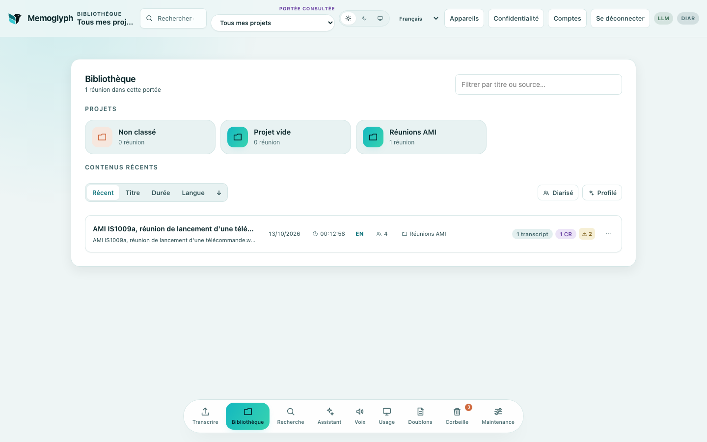
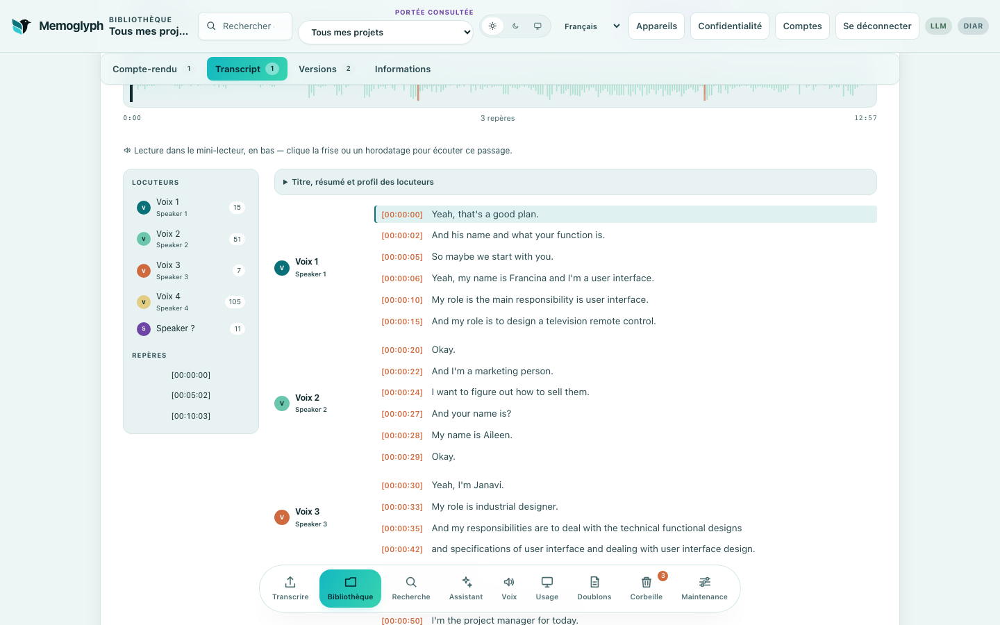
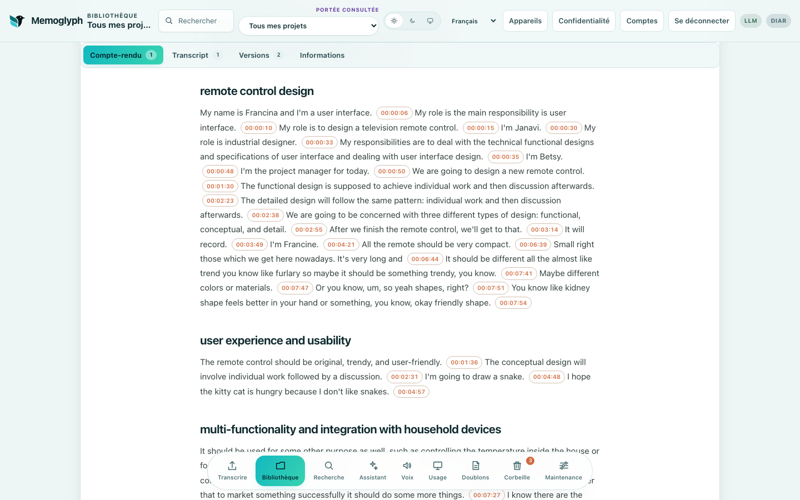
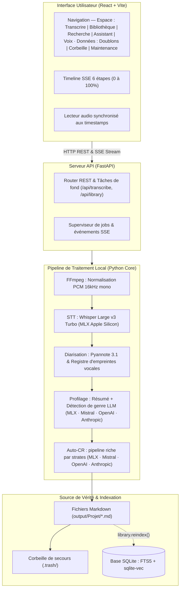

<p align="center">
  <picture>
    <source media="(prefers-color-scheme: dark)" srcset="docs/assets/brand/memoglyph-logo-horizontal-sombre.svg">
    
  </picture>
</p>

# Memoglyph

*[English](README.md) · Français*

**Transcriptions et comptes rendus de réunion en local, avec des citations à vérifier contre l'audio.**

Enregistrez un appel ou importez un fichier : Memoglyph vous donne une transcription horodatée avec les locuteurs, un compte rendu avec décisions, actions et questions ouvertes, et des réponses à vos questions sur l'ensemble de vos réunions. Chaque affirmation citée renvoie à la seconde où elle a été dite.


*La bibliothèque : vos projets et vos réunions récentes.*


*Une réunion : transcription avec locuteurs, frise d'onde et horodatages.*


*Le compte rendu : chaque affirmation porte des citations horodatées ; un clic joue l'audio à cet instant.*

<sub>Captures de la version actuelle, avec des données de démonstration uniquement : la réunion IS1009a de l'AMI Meeting Corpus (University of Edinburgh et partenaires du projet AMI), sous licence [CC BY 4.0](https://creativecommons.org/licenses/by/4.0/). Référence : J. Carletta et al., « The AMI Meeting Corpus: A Pre-announcement », *Machine Learning for Multimodal Interaction* (MLMI), 2005.</sub>

- **Vérifiable** : chaque affirmation cite son horodatage, et un chiffre qui n'a jamais été prononcé est écarté.
- **Local par défaut** : Whisper et un modèle local sur Apple Silicon. Mistral, OpenAI, Anthropic ou un serveur auto-hébergé compatible OpenAI, seulement si vous les choisissez.
- **Pour vous, ou pour une petite équipe, auto-hébergé** : des comptes, un espace privé chacun, un partage en lecture seule.
- **Niveaux de confidentialité** : une réunion ultra-confidentielle n'est jamais envoyée à un modèle cloud, sauf si son propriétaire l'autorise.
- **Prêt pour les agents** : un serveur MCP en lecture seule, borné à un compte.
- **Aucune télémétrie** : l'usage est noté en local ; rien ne part ailleurs qu'aux fournisseurs choisis et, au premier usage, aux téléchargements de modèles depuis Hugging Face.

## Ce qui fonctionne

Memoglyph transforme localement un fichier audio ou vidéo en un espace de travail
Markdown : transcription horodatée, locuteurs, comptes-rendus, recherche et
questions sur un corpus de réunions.

Le moteur est optimisé pour Apple Silicon. **Aucun service cloud n'est
nécessaire** : en mode local — le défaut — l'audio, les transcriptions et les
index restent sur la machine. Trois fournisseurs cloud optionnels existent pour
les comptes-rendus, l'Assistant et les faits de la réunion (**Mistral**, **OpenAI** et
**Anthropic**, Claude), et Mistral peut aussi assurer la transcription. Avec Anthropic, le
compte rendu et l'Assistant passent par Claude Haiku 5.5, les faits par Claude Sonnet 5.5 ; il faut les choisir explicitement, et ils envoient alors l'audio
et/ou le texte à l'API correspondante. La recherche par le sens s'appuie
**toujours** sur un modèle local ; le RAG, lui, RÉPOND avec le fournisseur choisi
— seule la recherche des passages reste locale.

> **État du projet.** L'application est utilisable pour transcrire,
> classer et rechercher. Le compte-rendu passe par un **unique pipeline riche par
> strates** (MAIN / SECONDARY / CLOSING / NOISE, rétention non destructive),
> identique pour les trois fournisseurs LLM ; seul le *profil d'exécution* varie
> selon la capacité (local vs distant). Les comptes-rendus affichent des
> horodatages compacts, conservent leurs extraits exacts dans une annexe dont
> l'intégrité est vérifiée déterministiquement, et un clic sur `[source]`
> positionne la lecture audio à l'instant cité. Une citation est un repère pour
> vérifier, pas une preuve : la transcription elle-même peut se tromper, et une
> citation n'*implique* pas forcément l'affirmation (l'étude P0–P5 a explicitement
> refusé d'intégrer les juges LLM/NLI actuels). Une **étiquette de sensibilité** à trois
> niveaux est portée par chaque document ; par défaut, un document **ultra-confidentiel**
> ne part vers aucun fournisseur cloud (transcription, compte-rendu, faits, Assistant),
> sauf si son propriétaire l'autorise pour ses propres documents. Voir
> [SPEC.md](SPEC.md) pour la conception. L'historique des décisions mesurées est
> tenu dans un journal interne, non publié.

- Transcription Whisper `large-v3-turbo` (local) ou Mistral Voxtral Mini (API cloud) avec langue détectée ou imposée. Au-delà de 50 minutes, Voxtral transcrit en tranches qui se recouvrent de 30 s, envoyées au rythme de la limite audio du palier par défaut de Mistral (3 600 s d'audio par minute) ; les horodatages sont recalés sur la réunion entière et les locuteurs raccordés d'une tranche à l'autre par leur temps de parole commun dans le recouvrement.
- Diarisation optionnelle avec Pyannote 3.1 (local) ou native Voxtral (Mistral API) et identification vocale entre réunions.
- **Génération automatique du compte-rendu** en fin de pipeline, via un **pipeline riche par strates** (extraction atomique bornée → validation déterministe d'horodatage → classification fermée + veto non destructif → structure bornée → rendu fidèle par unité → garde de contenance), avec barre de progression SSE en 6 étapes. Un seam unique (`report.generate_report`) sert **tous** les fournisseurs ; l'ancien `make_report` reste comme repli.
- **Quatre fournisseurs LLM, un seul contrat** : MLX local (`mlx_lm.server`, défaut), Mistral Chat API, OpenAI (Responses API) ou Anthropic (API Messages, Claude). Le fournisseur est choisi dans l'UI ; la chaîne de génération est la même, seul le profil d'exécution (tranche/lots/plafonds) change, résolu **par capacité** (`llm.est_local`), jamais par un nom de fournisseur.
- **Timeline UI adaptive** : affiche dynamiquement les détails du pipeline selon le moteur STT sélectionné.
- **Gabarits interrogatifs par genre** (`projet`, `steerco`, `interview`, `entretien_embauche`, `internal_briefing`, `town_hall`, `keynote`, `webinar`, `analyse_sportive`, `generique`) avec droit à l'abstention déterministe (*"S'il n'y en a aucun, réponds « aucun »"*).
- Projets isolés, avec une boîte **Non classé** lorsque aucun projet n'est sélectionné.
- **Bibliothèque** organisée par réunion et lecteur audio synchronisé avec les balises d'horodatage.
- **Archivage unitaire** depuis le lecteur de document ou l'Espace Réunion vers la Corbeille.
- Recherche **hybride** : plein-texte FTS5 et sémantique (`sqlite-vec`) fusionnés par Reciprocal Rank Fusion.
- Assistant RAG local ou cloud (Mistral / OpenAI / Anthropic), borné au projet courant ou explicitement étendu à tous.
- Comptes-rendus Markdown via MLX local, Mistral, OpenAI ou Anthropic, avec des citations à vérifier contre l'audio et des réserves de qualité visibles.
- **Étiquette de sensibilité** par réunion (`standard` / `confidential` / `ultra_confidential`), changée en une action pour toutes ses versions — par défaut, un document `ultra_confidential` ne part vers aucun fournisseur cloud : transcription, compte-rendu, faits et extraits de l'Assistant restent locaux. Chaque compte peut autoriser le cloud pour SES documents ultra-confidentiels dans **Confidentialité** (inactif par défaut, confirmé à l'activation, effectif aussitôt à la désactivation) ; le réglage n'ouvre rien pour ce qui est partagé ni pour un autre compte, et chaque envoi autorisé est consigné sans contenu (voir [SECURITY.md](SECURITY.md)). Une réunion porte une seule sensibilité ; une valeur inconnue est refusée (422), et la sensibilité est relue avant chaque appel cloud. **Confidentiel** est une étiquette pour les personnes : elle n'oriente rien d'elle-même, c'est l'humain qui décide de ce qui part où.
- **Cloud privé** : un serveur de modèle que vous hébergez (MLX, ou un « Serveur compatible OpenAI » comme Ollama, LM Studio ou vLLM, réglé par `.env`) ne compte comme local que sur la boucle locale de cette machine. Sur un autre hôte, il s'affiche « Cloud privé » et suit les règles du cloud, ultra-confidentiel compris.
- **Suivi d'usage & coût IA (FinOps)** : télémétrie par exécution dans un magasin séparé `usage.db`, **usage & coût par document** dans l'onglet Information et **tableau de bord Usage** borné projet avec drill-down forensique. Le coût local est estimé (hypothèse), le coût cloud suit des tarifs ratifiés et datés.
- **Serveur MCP en lecture seule** pour les agents (`./memoglyph mcp <identifiant>`) : projets, réunions, recherche, comptes rendus et, s'ils sont activés, faits de la réunion, bornés à un compte ; l'ultra-confidentiel du compte seulement s'il autorise le cloud pour lui ([docs/mcp.md](docs/mcp.md)).
- **Interface bilingue FR/EN** : détection de la langue du navigateur et bascule manuelle persistée (catalogue maison, sans dépendance i18n).
- Détection des doublons, Corbeille restaurable, purge vérifiée et maintenance des index.
- Archives d'écoute et FLAC fidèle à l'entrée des modèles pour retraitement.

Les fichiers `.md` sont la source de vérité. SQLite ne contient que des index dérivés et reconstructibles.

## Démarrage rapide

### Prérequis

- macOS sur Apple Silicon ;
- Python 3.11 et [uv](https://docs.astral.sh/uv/) ;
- Node.js 20.19+ ou 22.12+ ;
- `ffmpeg` ;
- `mlx-lm` pour les fonctions LLM locales (Apple Silicon), installé par `uv sync` ;
- `MISTRAL_API_KEY` (optionnel) pour les fonctions cloud Mistral.

```bash
brew install uv ffmpeg
uv sync --locked
npm --prefix ui ci
cp .env.example .env
./start.sh
```

L'application indique l'adresse retenue, normalement
[http://127.0.0.1:8770](http://127.0.0.1:8770). Si ces ports sont occupés, le
script choisit automatiquement la paire libre suivante.

```bash
./stop.sh     # Arrêter la stack
./restart.sh  # Redémarrer la stack (stop + start)
```

Le premier démarrage, et le premier après une mise à jour qui change l'index, peut
prendre plusieurs minutes sur une grande bibliothèque : l'API reconstruit son index
avant de répondre, et `./start.sh` l'attend (900 s au plus, réglable par
`MEMOGLYPH_ATTENTE_S`). Une API qui s'arrête pendant son démarrage est signalée tout
de suite, avec la fin de son journal.

Pendant un traitement (transcription, faits, voix, archives), `./stop.sh` et
`./restart.sh` refusent d'arrêter et le nomment : les traitements ne vivent qu'en
mémoire, un arrêt les perdrait. `./stop.sh --forcer` (ou `./restart.sh --forcer`)
arrête quand même. `./stop.sh` n'arrête que les serveurs lancés depuis son propre
dossier : une autre racine Memoglyph sur la même machine continue de tourner.

Pour ouvrir Memoglyph depuis un téléphone ou un autre ordinateur connecté au
même réseau local :

```bash
./start.sh --lan
```

Le script affiche l'adresse à ouvrir, par exemple `http://192.168.1.20:8770`,
et le nom Bonjour `http://<mac>.local:8770` — plus stable que l'IP, qui change
au bail DHCP. Seul Vite écoute sur le réseau ; FastAPI reste sur `127.0.0.1` et
les appels `/api` passent par le proxy du frontend. Le pare-feu macOS peut
demander d'autoriser Node à recevoir des connexions.

En mode LAN, Vite accepte les accès par IP et par nom `.local`. Pour un autre
nom d'hôte (DNS d'entreprise), l'ajouter via `MEMOGLYPH_ALLOWED_HOSTS`
(liste séparée par des virgules). Hors mode LAN, ce réglage n'a aucun effet.

**Connexion obligatoire partout, local compris.** Au premier lancement,
`./start.sh` affiche un code d'installation à usage unique ; l'interface ne montre
alors que l'écran « Créer le compte administrateur ». Pas d'inscription libre :
l'administrateur crée les autres comptes. Mot de passe oublié, sur la machine :
`./memoglyph reset-password <identifiant>`.

**Chaque compte ne voit que ses projets**, et son propre « Non classé ». Les
projets d'une bibliothèque d'avant les comptes n'ont pas de propriétaire : seuls
les administrateurs les voient. Pour les attribuer à un compte, simuler d'abord,
puis appliquer : `./memoglyph attribuer-bibliotheque <identifiant>`, puis la même
commande avec `--appliquer`. Seuls les manifestes de projet changent ; les Markdown
ne sont pas réécrits. Faites-le **avant de créer le moindre document** avec ce
compte : sinon il aura deux « Non classé » (le sien, créé avec le compte,
et celui de la bibliothèque) et une même personne pourra apparaître en deux voix, à
fusionner à la main. Un « Non classé » en trop, resté vide, se supprime à la main.

> **Attention :** en mode LAN, les autres appareils voient l'écran de connexion,
> mais le trafic circule en HTTP, sans chiffrement. Ne pas l'activer sur un Wi-Fi
> public ou non maîtrisé, et arrêter la stack après usage avec `./stop.sh`.

En mode LAN comme en local, l'API refuse toute requête qui modifie l'état si son
en-tête `Origin` n'est ni l'hôte ni l'interface elle-même : une page d'un autre site
ne peut rien déclencher. Après cinq échecs de connexion en 15 minutes, pour un même
identifiant ou une même adresse, chaque essai attend un délai croissant, plafonné à
15 minutes ; `./memoglyph reset-password <identifiant>` lève le blocage du compte.

Le premier usage télécharge Whisper depuis Hugging Face. Pour activer les
comptes-rendus, profils et réponses RAG :

```bash
# Le modèle MLX se télécharge au premier usage : mlx-community/Qwen3-4B-Instruct-2507-4bit
# Faits de la réunion (ECL) : expérimentaux, désactivés par défaut ; MEMOGLYPH_FAITS=1 les active.
# Seulement alors, en local : ibm-granite/granite-4.2-8b-q4-mlx (4,9 Go), à télécharger
# une fois (hf download ibm-granite/granite-4.2-8b-q4-mlx) ; absent, l'ECL le signale et retombe
# sur le modèle ci-dessus
```

### Diarisation et signatures vocales

La diarisation est un groupe optionnel. Elle nécessite aussi un `HF_TOKEN` dans
`.env` et l'acceptation des conditions du modèle pyannote indiquées dans
[.env.example](.env.example). Le jeton reste exigé même une fois le modèle en cache ;
sans lui, les transcriptions sont sans locuteurs, et le travail comme la réunion disent
pourquoi.

```bash
uv sync --locked --group diar
```

## Enregistrer un appel (bêta)

Le compagnon de barre de menus enregistre un appel (le micro et le son de l'application
d'appel) ou un replay, et confie le fichier à Memoglyph. Il est en **bêta** et **pour macOS
seulement**. Pour le compiler et l'installer :

```bash
make companion
```

Il s'installe dans `/Applications` ; si `/Applications` n'est pas accessible en écriture,
il le dit et s'installe dans `~/Applications`. `DEST=<dossier>` l'installe ailleurs. Le
Finder montre ensuite l'application. Son menu « Démarrer en Visio » liste d'abord les
appels en cours, puis une ligne par application ouverte, et propose aussi « Tout le son du
Mac ». Détail : [compagnon/README.md](compagnon/README.md) et
[docs/compagnon-capture.md](docs/compagnon-capture.md).

## Exemples d'usage (Use Cases)

Memoglyph adapte automatiquement la structure du compte-rendu au genre de la réunion grâce à des gabarits interrogatifs ciblés :

- 📁 **Réunion de Projet / Sync d'équipe (`projet`)** : Extrait les décisions adoptées, les engagements individuels attribués (*qui fait quoi*), les jalons/dates limites annoncés, les questions ouvertes et les blocages/dépendances.
- 📊 **Comité de Pilotage (`steerco`)** : Synthétise l'état d'avancement, les écarts de planning/budget, les arbitrages rendus, les alertes majeures et les demandes d'approbation soumises.
- 🎙️ **Interview & Podcast (`interview`)** : Identifie les thèses de la personne interrogée, les faits notables, les annonces et les conseils/recommandations partagés.
- ⚙️ **Briefing Opérationnel (`internal_briefing`)** : Clarifie les consignes terrain, les contraintes, les cas particuliers et le point de contact/canal d'escalade référent.
- 🏛️ **Réunion Plénière / Town Hall (`town_hall`)** : Présente les orientations stratégiques, les réponses apportées aux questions des collaborateurs et les rendez-vous à venir.
- 🎓 **Webinaire ou Keynote (`webinar`, `keynote`)** : Restitue la démonstration, les arguments clés, les données présentées et la session de Q&A.

## Parcours produit

1. Choisir un projet actif ou conserver **Non classé**.
2. Déposer un fichier audio ou vidéo dans **Transcrire** et cocher les enrichissements souhaités (Locuteurs, Profilage, Compte-rendu automatique).
3. Suivre le traitement en temps réel via la **timeline à 6 étapes** (Préparation → STT → Diarisation → Profilage → Compte-rendu Map-Reduce → Finalisation).
4. Ouvrir la réunion dans la **Bibliothèque** pour relire le transcript, écouter l'audio synchronisé et consulter le compte-rendu généré.
5. Utiliser **Recherche** ou **Assistant** pour interroger le corpus en langage naturel.
6. Archiver unitairement un transcript ou un compte-rendu depuis le lecteur vers la **Maintenance → Corbeille** pour restauration ou purge définitive.

## Limites connues

- Les citations sont des repères pour vérifier la transcription et l'audio, pas des preuves. Le contrôle confirme qu'un extrait figure tel quel dans la transcription au timestamp annoncé ; mais la transcription peut se tromper (un mot ou un chiffre mal entendu, une voix attribuée à la mauvaise personne), et un modèle peut tirer d'un extrait ce qu'il ne dit pas. Cliquez sur la citation, écoutez l'audio, et vérifiez ce qui compte avant de vous y fier. Le profil LLM aide au choix du gabarit mais n'est jamais remis au générateur comme parole source. Une relecture humaine reste nécessaire pour les inférences importantes. Les anciens comptes-rendus ne sont pas modifiés ni déclarés vérifiés rétroactivement.
- Un montant à décimales peut perdre sa virgule à la transcription : Whisper écrit « 1250 » pour « douze cinquante ». Le texte ne permet pas de le voir, puisque le chiffre est bien dans la citation : écoutez la citation d'un montant avant de vous y fier (mesure dans [docs/ecl.md](docs/ecl.md), « La transcription et les chiffres »).
- Une boucle de répétition de Whisper est re-décodée une fois ; si elle persiste, elle est repliée avec sa marque et signalée en réserve dans la réunion.
- La stratégie **Map-Reduce** découpe automatiquement les longs enregistrements par tranches de 15 000 caractères, assurant une couverture complète même sur les transcripts étendus.
- Une réunion avec beaucoup de voix peut être sur-segmentée si aucune borne de locuteurs n'est renseignée.
- Deux anciens transcripts n'ont plus leur média original et ne peuvent donc pas recevoir rétroactivement une archive FLAC fidèle.

## Architecture et données



- `core/` contient le pipeline et la logique métier indépendants de l'UI.
- `api/` expose les jobs, la progression SSE et les ressources de la bibliothèque.
- `ui/` contient l'application React et son proxy de développement.
- `output/` contient les données personnelles et n'est jamais versionné.
- `index.db` est dérivé de `output/` et peut être reconstruit.

La conception détaillée est dans [SPEC.md](SPEC.md). Le journal des décisions
mesurées est interne et n'est pas publié.

## Configuration utile

Les réglages se lisent sous le préfixe `MEMOGLYPH_*`. Les clés et modèles cloud sont lus **sans préfixe**
(`MISTRAL_*`, `OPENAI_*`). Liste complète et défauts : [SPEC.md §14](SPEC.md).

| Variable | Usage |
|---|---|
| `HF_TOKEN` | accès au modèle pyannote gated (diarisation) |
| `MEMOGLYPH_MLX_LLM_MODEL` | modèle LLM local, `mlx-community/Qwen3-4B-Instruct-2507-4bit` par défaut |
| `MEMOGLYPH_FAITS` | `1` active les faits de la réunion (ECL), expérimentaux, désactivés par défaut : onglet « Faits », ses routes, l'outil MCP `lire_faits`, `ecl-extraire` |
| `MEMOGLYPH_ECL_MLX_MODEL` | modèle local des faits de la réunion (ECL), `ibm-granite/granite-4.2-8b-q4-mlx` par défaut ; vide : celui du LLM local |
| `ANTHROPIC_API_KEY` | clé API Anthropic (moteur `anthropic`, Claude Haiku 5.5 par défaut) |
| `MEMOGLYPH_ECL_ANTHROPIC_MODEL` | modèle des faits de la réunion (ECL) chez Anthropic, `claude-sonnet-5-5` par défaut |
| `MISTRAL_API_KEY` | clé API Mistral pour STT Voxtral et LLM Chat |
| `MISTRAL_STT_MODEL` | modèle STT Mistral, `voxtral-mini-2602` par défaut |
| `MISTRAL_CHAT_MODEL` | modèle LLM Mistral, `ministral-14b-2512` par défaut (`mistral-small` a un plafond nul au palier par défaut) |
| `MEMOGLYPH_MISTRAL_STT_TRANCHE_S` | au-delà de cette durée, Voxtral transcrit en tranches d'au plus cette durée, `3000` (50 min) par défaut ; `0` : jamais découper |
| `MEMOGLYPH_MISTRAL_STT_RECOUVREMENT_S` | recouvrement entre deux tranches Voxtral, `30` s par défaut |
| `MEMOGLYPH_MISTRAL_AUDIO_S_PAR_MINUTE` | limite audio du palier Mistral suivie par les envois, `3600` s d'audio par minute par défaut |
| `OPENAI_API_KEY` | clé API OpenAI pour les comptes-rendus (Responses API) |
| `MEMOGLYPH_OPENAI_CHAT_MODEL` | modèle LLM OpenAI, `gpt-5.6-luna` par défaut |
| `MEMOGLYPH_MLX_PORT` | port épinglé du `mlx_lm.server`, `8772` par défaut |
| `MEMOGLYPH_PORT_BASE` | port UI de base, API sur le suivant |
| `MEMOGLYPH_ATTENTE_S` | attente maximale du démarrage par `start.sh`, `900` s par défaut |
| `MEMOGLYPH_UI_HOST` | écoute UI, `127.0.0.1` par défaut ; préférer `--lan` pour `0.0.0.0` |
| `MEMOGLYPH_ALLOWED_HOSTS` | mode LAN : noms d'hôte autorisés en plus de l'IP et de `.local` (CSV) |
| `MEMOGLYPH_USAGE_DB` | chemin du magasin de télémétrie FinOps `usage.db` (tests / emplacement alternatif) |
| `MEMOGLYPH_EMBED_LOCAL_MODEL` | modèle d'embeddings local, `intfloat/multilingual-e5-large` par défaut |
| `MEMOGLYPH_KEEP_FAITHFUL` | conserve le FLAC fidèle, activé par défaut |

Exemple de ports imposés :

```bash
MEMOGLYPH_UI_PORT=9200 MEMOGLYPH_API_PORT=9201 ./start.sh
```

Les logs de développement sont écrits dans `memoglyph-api.log` et `memoglyph-ui.log`. La
documentation interactive de l'API (`/docs`, `/redoc`, `/openapi.json`) est fermée : elle
décrivait toute l'API à qui n'était pas connecté.

## Provenance des générations

Chaque nouveau transcript et chaque nouveau compte-rendu porte un bloc
`pipeline` dans son front-matter YAML. Il identifie la version de Memoglyph, la
révision Git et l'état du code, les réglages effectifs des modèles et un hash du
code pertinent. Le compte-rendu référence aussi le fingerprint du transcript
qui lui a servi de source.

Le bloc transcript inclut également le SHA-256 du flux PCM normalisé réellement
fourni aux modèles. Lorsqu'un document est retraité depuis une archive fidèle,
`derived_from_document_id` relie la nouvelle génération à l'ancienne sans
réutiliser son identité ni l'écraser.

Ce fingerprint décrit le contexte de génération ; il ne promet pas une sortie
bit à bit reproductible des modèles non déterministes. Les anciens documents ne
sont pas modifiés automatiquement : l'absence du bloc signifie
`legacy_unknown`. Aucun secret, hôte de service ou chemin local n'est consigné.

## Sauvegarde et restauration

Une sauvegarde complète couvre `output/` (les Markdown, qui font foi, et l'audio
archivé), `index.db` (index et **registre des voix**, qui ne se régénère pas),
`auth.db` (comptes, jetons d'appareil, partages) et `usage.db`. Memoglyph arrêté :

```bash
.venv/bin/python tools/sauvegarder.py sauvegarder --vers ~/Sauvegardes
.venv/bin/python tools/sauvegarder.py restaurer ~/Sauvegardes/memoglyph-AAAA-MM-JJ-HHhMMSS
```

L'outil refuse de tourner pendant que Memoglyph tourne, vérifie chaque fichier avant de
restaurer et ne supprime rien. Détail, périmètre et vérification :
[docs/sauvegarde.md](docs/sauvegarde.md).

## Serveur MCP pour les agents

`./memoglyph mcp <identifiant>` expose aux agents (Claude, Codex, Cursor…), sur stdio et
en lecture seule, ce que sait la bibliothèque : projets, réunions, recherche hybride,
comptes rendus avec leurs citations horodatées, faits de la réunion (ECL). Il sert un seul compte,
borné à sa portée de lecture. Le client peut être un modèle cloud : un document
`ultra_confidential` n'est rendu que s'il appartient au compte servi et que ce compte
autorise le cloud pour son ultra-confidentiel (panneau **Confidentialité**). Outils,
garanties, configuration d'un client :
[docs/mcp.md](docs/mcp.md).

## Maintenance des archives historiques

L'écran **Maintenance** distingue les archives fidèles déjà présentes, les
originaux encore exploitables et les documents devenus impossibles à compléter.
Le CLI simule toujours par défaut :

```bash
.venv/bin/python -m core.faithful_backfill
.venv/bin/python -m core.faithful_backfill --apply
```

Le mode `--apply` n'utilise jamais l'archive d'écoute comme original, vérifie le
PCM 16 kHz mono et publie chaque FLAC atomiquement sans écrasement.

### Corbeille et suppression

Archiver retire le Markdown actif de la bibliothèque, de FTS5, des vecteurs
`sqlite-vec`, du RAG et du registre des voix. Le Markdown, les archives audio et
les empreintes restent dans la Corbeille pour permettre une restauration réelle.
Lorsqu'un transcript possède des comptes-rendus liés par leur identifiant stable,
la confirmation les liste et les archive avec leur source.

La suppression définitive d'un élément de la Corbeille retire aussi ses
empreintes et ses archives audio, puis vérifie qu'aucune des huit traces connues
ne subsiste. Une trace partagée avec une autre copie récupérable est conservée.
Si un magasin résiste, le Markdown et son manifeste restent visibles : l'erreur
est annoncée et l'opération peut être relancée.

### Portée projet — et la contrepartie sur les voix

Un projet **borne l'accès** aux documents, plus seulement l'affichage : lire,
télécharger, écouter, générer un compte-rendu, déplacer ou supprimer exige de
dire depuis quelle portée (`view_scope`), sans valeur par défaut. La portée d'un
document est celle de son **dossier** ; `view_scope=all` reste le seul
élargissement, explicite, et les liens partagés `?projet=all` fonctionnent.

**Les voix sont communes à tous les projets d'un compte, et à lui seul.** Une
voix nommée dans un projet est reconnue et nommée dans les autres projets du
même compte : reconnaître la même personne d'une réunion à l'autre suppose un
espace de voix commun, et cloisonner le registre par projet obligerait à
réapprendre chaque interlocuteur dans chaque projet. Entre deux comptes, en
revanche, rien ne passe : la même personne enregistrée par deux comptes fait
deux voix, et un nom donné par l'un n'est jamais montré ni suggéré à l'autre.
Détail en §7 et §8 du SPEC.

## Développement et tests

Les captures d'écran et les démonstrations s'appuient sur un corpus public et libre
de droits, l'AMI Meeting Corpus : voir [docs/corpus-demo.md](docs/corpus-demo.md).

```bash
make hooks       # installe le hook pre-push local
make check       # lock uv, Ruff, tests Python et UI, lint et build
make test-cov    # couverture core + API
make test-ml     # vrais médias et modèles ; scénarios indisponibles ignorés
make test-ml-strict
```

### Ce que les tests ML exigent de la machine

Ils ne tournent PAS en intégration continue, et pas par oubli : le profil que
la CI installe n'a ni `torch` ni `mlx-whisper`. Cette porte est donc manuelle,
et c'est la seule vérification du pipeline réel qui existe.

| Module | Ce qu'il exige |
|---|---|
| `tests/ml/test_stt_real.py` | un audio de référence (voir ci-dessous) |
| `tests/ml/test_ami_reponse_connue.py` | le corpus de démo AMI (`python tools/corpus_demo.py`), `HF_TOKEN`, `mlx_whisper`, le LLM local |
| `tests/unit/test_embed.py` | le modèle d'embedding local |

**L'audio de référence** vient de l'une de ces deux sources, dans cet ordre :

1. la variable `MEMOGLYPH_ML_AUDIO`, pointant un fichier existant ;
2. le premier fichier audio de `tests/fixtures/audio/`.

Ce dossier est **gitignoré** : l'audio est personnel, il ne part pas sur le
distant. Un extrait de 30 secondes suffit — les tests vérifient des propriétés
(horodatages monotones, absence de boucle de répétition, granularité des
segments), pas un contenu.

```bash
ffmpeg -i "chemin/vers/votre-enregistrement.m4a" -t 30 -c copy \
    tests/fixtures/audio/extrait-30s.m4a
```

Sans cet extrait, sept tests de propriété STT se SAUTENT — et un test qui se
saute ne rapporte rien.

Les tests ML s'exécutent dans des processus isolés afin qu'un crash natif
Metal/MLX n'emporte pas le superviseur. Ils vérifient des propriétés —
horodatages monotones, absence de boucles, granularité — plutôt qu'un texte exact.

Les fichiers `requirements*.txt` restent fournis pour compatibilité `pip`, mais
`pyproject.toml` et `uv.lock` constituent le chemin d'installation de référence.

## Modèles par défaut

| Composant | Modèle |
|---|---|
| Transcription (local, défaut) | `mlx-community/whisper-large-v3-turbo` |
| Transcription (cloud) | `voxtral-mini-2602` (Mistral API) |
| Diarisation (local) | `pyannote/speaker-diarization-community-1` |
| Diarisation (cloud) | Native Voxtral (Mistral API) |
| LLM local (défaut) | `mlx-community/Qwen3-4B-Instruct-2507-4bit` via `mlx_lm.server` |
| Faits de la réunion, ECL (local) | `ibm-granite/granite-4.2-8b-q4-mlx`, réflexion coupée ; repli sur le LLM local s'il est absent |
| LLM cloud (Mistral) | `ministral-14b-2512` (Mistral API) |
| LLM cloud (OpenAI) | `gpt-5.6-luna` (Responses API) |
| LLM cloud (Anthropic) | `claude-haiku-5-5` (API Messages) |
| Faits de la réunion, ECL (cloud, Anthropic) | `claude-sonnet-5-5` |
| Embeddings (local, recherche/RAG) | `intfloat/multilingual-e5-large` |

## Licence

Apache-2.0 — voir [LICENSE](LICENSE) et [NOTICE](NOTICE). Les modèles conservent leurs licences respectives.
Le nom et le logo Memoglyph ne sont pas couverts par cette licence : voir
[docs/assets/brand/](docs/assets/brand/README.md).
