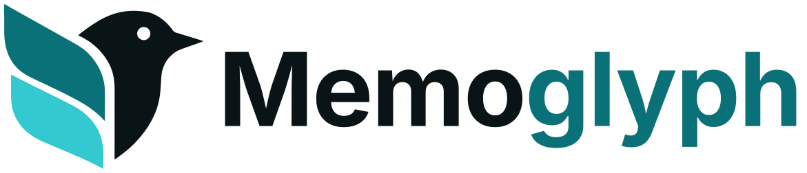
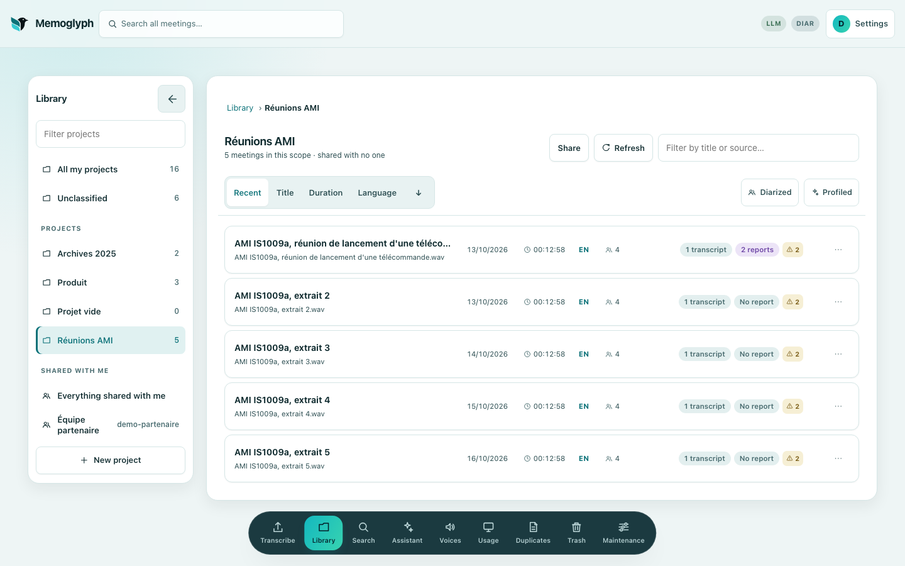
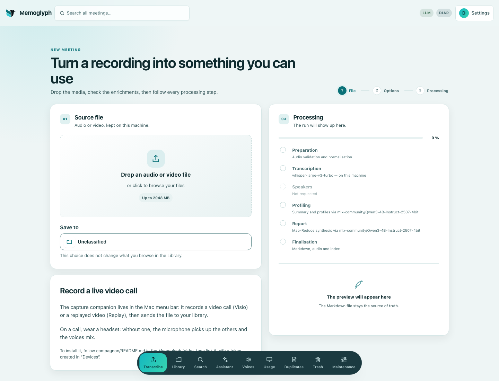
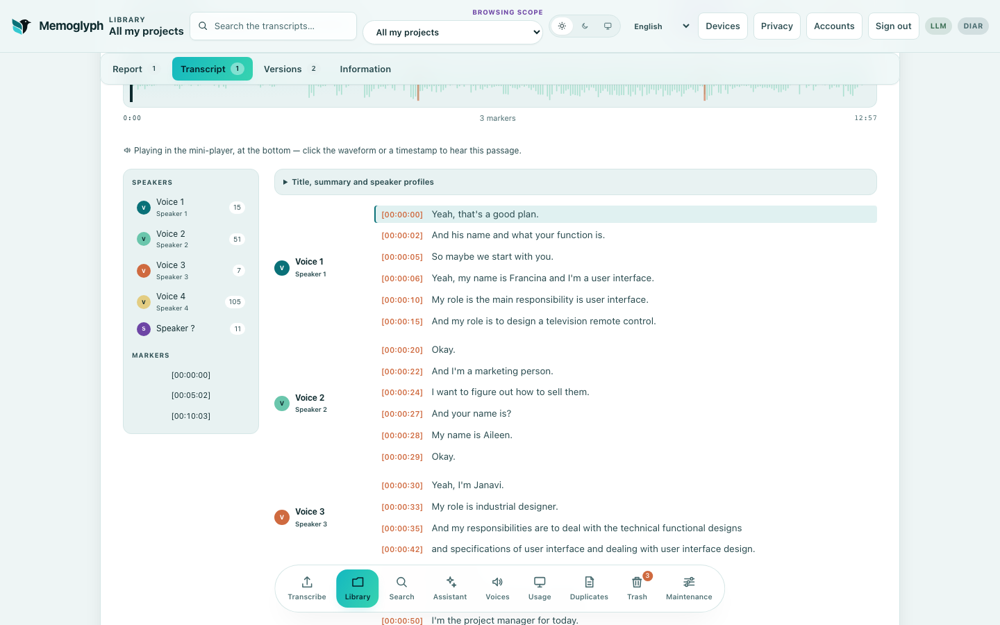
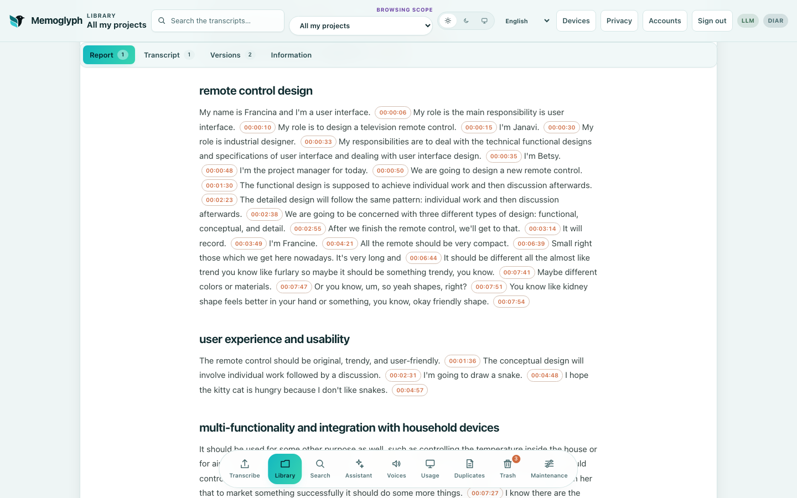

<!-- Generated file: edit readme/, then run make readme -->
<p align="center">
  <picture>
    <source media="(prefers-color-scheme: dark)" srcset="docs/assets/brand/memoglyph-logo-horizontal-sombre.svg">
    
  </picture>
</p>

# Memoglyph

*English · [Français](README.fr.md)*

**Meeting transcripts and reports, local by default, with citations that can be checked against the audio.**


*The library: the meetings of a project.*

<sub>The meeting screenshots on this page show demo data only: meeting IS1009a of the AMI Meeting Corpus (University of Edinburgh and the AMI project partners), licensed under [CC BY 4.0](https://creativecommons.org/licenses/by/4.0/). Reference: J. Carletta et al., "The AMI Meeting Corpus: A Pre-announcement", *Machine Learning for Multimodal Interaction* (MLMI), 2005.</sub>

## The problem

A meeting leaves decisions, actions and figures that are hard to find again. The recording is long, the summary is short, and nothing links the two.

A summary written by a model can also be wrong without showing it. Checking one claim means finding the passage, then the second of audio where it was said.

Memoglyph turns a recording into a timestamped transcript and a report. Each statement kept in the report carries a citation verified in the transcript, and the citation opens the audio at that second.

## In three steps

### 1. Transcribe

An audio or video file dropped on the Transcribe screen, up to 2,048 MB by default, is filed in a project and, by default, processed on the Mac.


*The Transcribe screen: file, project and processing steps.*

### 2. Read

The transcript shows the waveform, the timestamps and, when diarization is installed, the speakers.


*A meeting: transcript with speakers, waveform and timestamps.*

### 3. Check

The report lists, according to the type of meeting, decisions, actions and open questions. The statements of the report carry timestamped citations, and a click plays the audio at that moment.


*A report whose statements carry timestamped citations; a click plays the audio at that moment.*

## Local or online, as chosen

By default, everything runs on the Mac: Whisper for transcription, and a local MLX language model for reports and the assistant. Semantic search also uses a local embedding model by default.

An online model can be added when needed: Mistral, OpenAI, Anthropic, OpenRouter or Groq, or any other service in the OpenAI format through the `compatible` provider. Mistral can also transcribe, with Voxtral.

Both can be combined according to the sensitivity of each meeting. A document labelled ultra-confidential goes to no online provider unless its owner allows it for their account. Details, in French: [docs/local-et-en-ligne.md](docs/local-et-en-ligne.md).

There is no telemetry. Usage is recorded locally, and nothing leaves the machine except calls to the providers chosen and, on first use, model downloads from Hugging Face.

## Five commands to start

The requirements are a Mac with Apple Silicon and Homebrew, Python 3.11 with [uv](https://docs.astral.sh/uv/), Node.js 20.19+ or 22.12+, and `ffmpeg`. The commands run from a clone of the repository.

```bash
brew install uv ffmpeg
uv sync --locked
npm --prefix ui ci
cp .env.example .env
./start.sh
```

The app opens at [http://127.0.0.1:8770](http://127.0.0.1:8770). If that port is taken, `./start.sh` picks the next free pair and prints the address. Models are downloaded on first use.

The app stops with `./stop.sh`; a running job makes it refuse and name the job, and `--forcer` stops it anyway.

On first launch, `./start.sh` prints a one-time installation code. The app then shows a single screen to create the administrator account, and the administrator creates the other accounts.

A library created before accounts existed is handed to an account with `./memoglyph attribuer-bibliotheque <username>`, run before creating any new document with that account. The steps are in [docs/comptes-et-partage.md](docs/comptes-et-partage.md), in French.

## Further reading

The documents below are in French, like the codebase and most technical docs.

- [Companion](docs/compagnon-capture.md): the menu bar app that records a call and sends it to Memoglyph, in beta and for macOS only.
- [Accounts and sign-in](docs/comptes-et-partage.md): sign-in, accounts, handing a library over to an account, and the protections of the API.
- [MCP for agents](docs/mcp.md): a read-only server scoped to one account.
- [Diarization](docs/installation.md#diarisation-et-signatures-vocales): the separate installation and the Hugging Face token.
- [Backup](docs/sauvegarde.md): what a full backup covers, and how to restore it.
- [All documents](docs/README.md): features, configuration, architecture and limits.

## Limits

- Citations are landmarks for checking, not proofs. The check confirms that a quote is in the transcript at the stated timestamp, but the transcript itself can be wrong.
- An amount with decimals can lose its decimal point in transcription ("1250" for "twelve fifty"), and the text alone does not show it.
- Diarization needs a separate installation and a Hugging Face token.
- Memoglyph is designed for, and tested on, a Mac with Apple Silicon.
- The companion is in beta.

## Development and license

```bash
make hooks
make check
```

`make check` runs the lock check, Ruff, the Python and UI tests, the lint and the build. Contribution and security notes are in [CONTRIBUTING.md](CONTRIBUTING.md) and [SECURITY.md](SECURITY.md); development details, in French, are in [docs/developpement.md](docs/developpement.md).

The code is under the Apache-2.0 license ([LICENSE](LICENSE), [NOTICE](NOTICE)). Models keep their own licenses. The Memoglyph name and logo are not covered by that license; the brand files are described in [docs/assets/brand/](docs/assets/brand/README.md).

Version v1.2.0.
