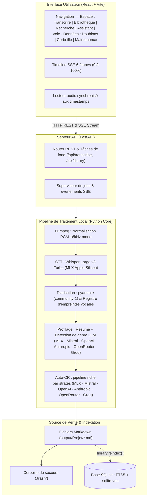

# Architecture et données

Organisation du code, des fichiers et des données.

- `core/` contient le pipeline et la logique métier indépendants de l'UI.
- `api/` expose les jobs, la progression SSE et les ressources de la bibliothèque.
- `ui/` contient l'application React et son proxy de développement.
- `output/` contient les données personnelles et n'est jamais versionné.
- `index.db` est dérivé de `output/` et peut être reconstruit.

La conception détaillée est dans [SPEC.md](../SPEC.md). Le journal des décisions
mesurées est interne et n'est pas publié.

---

[Retour au README](../README.fr.md)
